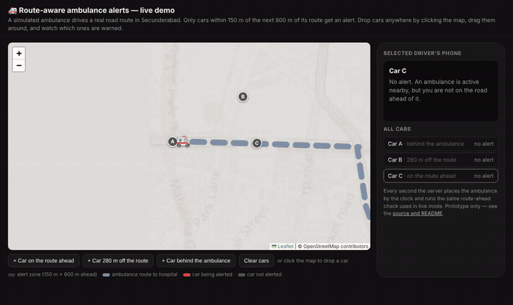

# 🚑 Ambulance Proximity Alert

Warn only the drivers on the road **ahead** of an ambulance, 30–60 seconds before it reaches them — not everyone within a radius.

**▶ Try it:** open `/demo` on the deployed app — one screen, no phones or GPS needed.
**🎬 Video:** [docs/demo.mp4](docs/demo.mp4) (50 s walkthrough)



## The problem

Drivers learn an ambulance is coming only when they hear the siren or see it in the mirror — often when it is already stuck behind them, with no room left to clear a lane.

This project started with a pregnant relative who didn't reach the hospital in time because her ambulance was caught in traffic. Navigation apps have changed how people drive since then, but they still say nothing when an ambulance is coming up behind you.

## The idea: route-ahead alerts

1. When a mission starts, the ambulance's road route to the hospital is fetched (OSRM / OpenStreetMap).
2. As the ambulance moves, the system tracks how far along that route it is.
3. A driver is alerted only if they are within **150 m of the next 800 m** of the ambulance's route.
4. Cars behind the ambulance, on roads further away, or beyond 800 m get nothing. The alert says how far behind the ambulance is along the road.

In a navigation app this gets much better: the app already knows each driver's *planned* route, so it can check whether the two routes share road segments in the same direction — on the phone, without the driver's location leaving it.

## Try it

| Mode | What you need | URL |
| --- | --- | --- |
| **One-screen demo** | A browser | `/demo` |
| Live, ambulance | A phone with GPS, the operator access code | `/ambulance` |
| Live, driver | A second phone with GPS | `/driver` |

In the demo, a simulated ambulance drives 4 km of real road in Secunderabad, Hyderabad at 50 km/h. Three cars are placed for you (ahead, 280 m off the route, behind); click the map to drop more, or drag them. The server runs the same check the live mode uses.

## Privacy and trust

- **Drivers' locations are never shared.** In the prototype, a driver's phone sends its position to the server so the server can run the check. The server keeps only the latest point per driver, forgets it after 30 seconds of silence, and never returns it to any other client. The "other traffic" on the driver map is simulated.
- **Only the ambulance's position and route are broadcast.**
- **Only a verified ambulance can go live.** Verification issues a mission token; starting, updating and stopping a mission all require it, and nobody else can start a mission while one is live. On a public deployment, set `OPERATOR_KEY` so the ambulance page also needs a shared access code.
- **In production,** ambulance location should come from the ambulance service's dispatch or fleet-tracking system, not a phone the crew holds. That is the real answer to fake-ambulance abuse.

## What's real and what's not

| Part | Status |
| --- | --- |
| Road routing (OSRM, OpenStreetMap) | ✅ Real |
| Route-ahead check (150 m wide, 800 m ahead) | ✅ Real |
| Live GPS from two phones | ✅ Real |
| One-screen demo ambulance | ⚠️ Simulated, for reviewers |
| Other traffic on the driver map | ⚠️ Simulated |
| Crew identity check (name, license, photo) | ⚠️ Mock — nothing is actually verified beyond the operator code |
| Driver's own route and heading | ❌ Not used yet — a car on a parallel road within 150 m can get a false alert |

Other limits: one ambulance at a time, in-memory state (single server process), and OSRM's free public demo server. If OSRM is unreachable, the route falls back to a straight line and the ambulance page says so.

## Prior art

[HAAS Alert Safety Cloud](https://www.haasalert.com/safety-cloud-digital-alerting-waze-maps) already sends emergency-vehicle alerts to drivers through Waze, Apple Maps and some cars in the US, triggered when a responder's lights or siren are on. This project explores two additions: alerting based on where the ambulance is *going* (and, inside a navigation app, where the driver is going), and markets without that coverage yet, such as Indian cities.

## Tech

- **Backend:** Python, Flask, gunicorn; in-memory state, no database
- **Routing:** [OSRM](http://project-osrm.org/) public demo server; the demo route is stored in `static/demo_route.json`
- **Frontend:** vanilla HTML/JS and [Leaflet](https://leafletjs.com/) with OpenStreetMap tiles
- **Geometry:** haversine distance and point-to-segment projection in a local flat-earth frame (`route_ahead_check` in `app.py`)

## Running it

**Locally:**

```bash
pip install -r requirements.txt
python3 app.py            # http://localhost:5000 — set FLASK_DEBUG=1 for the debugger (binds to 127.0.0.1 only)
```

**On Render:** this repo includes a `render.yaml` blueprint. In Render, choose **New → Blueprint**, connect the repo, and it will build with gunicorn and generate an `OPERATOR_KEY` (find it under the service's Environment tab and give it to the ambulance operator). Use a paid instance for anything you share: the free plan sleeps after inactivity and takes about 30 seconds to wake.

Keep a single gunicorn worker (`--workers 1`): state lives in memory, so all requests must reach the same process.

## Status

Early-stage prototype, built to test whether route-aware alerts are technically feasible. Not production-ready. Feedback is welcome from anyone working on maps, navigation, or emergency response.

## License

[Apache-2.0](LICENSE)
